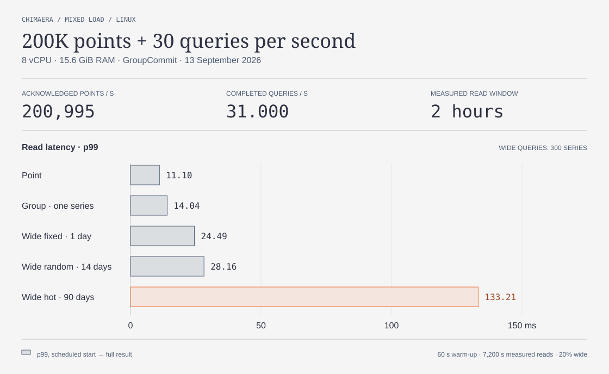

<p align="center">
  
</p>

[English](README.md)

# Chimaera

Chimaera — встраиваемый движок хранения временных рядов на Rust. Он работает внутри приложения, принимает атомарные пакеты точек и читает данные по согласованному снимку.

- Запись через WAL с режимами `Sync`, `GroupCommit` и `Async`.
- Точечное чтение, потоковое чтение диапазона и группировка нескольких рядов.
- Фоновое слияние L0/L1/L2 и точные агрегатные сводки.
- Сроки хранения исходных точек и агрегатов, snapshot/restore, verify и JSONL.

[Архитектура движка → DESIGN.ru.md](docs/DESIGN.ru.md)

## Быстрый запуск

Нужны Rust 1.96 или новее и C toolchain. Из каталога исходников:

```sh
cargo build --locked --bins
cargo run --quiet --locked --example quickstart
```

[Пример](examples/quickstart.rs) создаёт временную базу, записывает две точки, читает их и проверяет повторное открытие. После завершения временные данные удаляются.

```text
point: 10
group: count=2, sum=22.5
reopen: 12.5
```

Для подключения к приложению рядом с исходниками движка:

```toml
[dependencies]
chimaera = { path = "../chimaera" }
```

## Примеры использования

После подключения зависимости выше каждый пример можно поместить в `src/main.rs` своего приложения. Первый запустите с новым каталогом `metrics-db`; следующие два читают эту базу из того же рабочего каталога.

### Записать пакет и прочитать точку

Ключ ряда состоит из `(space_id, bucket_id, key)`. Время задаётся в микросекундах Unix. Режим `Sync` подтверждает пакет после синхронизации WAL.

```rust
use chimaera::{Durability, OpenOptions, Point, SeriesKey, Storage};

fn main() -> chimaera::Result<()> {
    let storage = Storage::open("metrics-db", OpenOptions::default())?;
    let sensor_a = SeriesKey::new(1, 1, 1);
    let sensor_b = SeriesKey::new(1, 1, 2);
    let start_us = 1_788_220_800_000_000;

    storage.write_batch(
        vec![
            Point::new(sensor_a, start_us, 10.0)?,
            Point::new(sensor_a, start_us + 1_000_000, 20.0)?,
            Point::new(sensor_b, start_us, 30.0)?,
            Point::new(sensor_b, start_us + 1_000_000, 40.0)?,
        ],
        Durability::Sync,
    )?;

    if let Some(point) = storage.point(sensor_a, start_us)? {
        println!("point: {}", point.value);
    }
    storage.close()
}
```

Результат: `point: 10`.

### Прочитать диапазон потоком

`scan` возвращает точки по возрастанию времени. Начало диапазона включено, конец исключён: `[from_us, to_us)`. Цикл получает точки по одной, без сбора всего результата в коллекцию.

```rust
use chimaera::{OpenOptions, SeriesKey, Storage};

fn main() -> chimaera::Result<()> {
    let storage = Storage::open(
        "metrics-db",
        OpenOptions {
            create_if_missing: false,
            ..OpenOptions::default()
        },
    )?;
    let series = SeriesKey::new(1, 1, 1);
    let start_us = 1_788_220_800_000_000;

    for point in storage.scan(series, start_us, start_us + 2_000_000)? {
        let point = point?;
        println!("{}: {}", point.timestamp_us, point.value);
    }
    storage.close()
}
```

Будут прочитаны две точки со значениями `10` и `20`.

### Сгруппировать несколько рядов по минутам

`Combined` объединяет оба ряда в один результат для каждого интервала. Запрос считает число точек и сумму значений за каждую минуту.

```rust
use chimaera::{GroupRequest, GroupScope, OpenOptions, SeriesKey, Storage};

fn main() -> chimaera::Result<()> {
    let storage = Storage::open(
        "metrics-db",
        OpenOptions {
            create_if_missing: false,
            ..OpenOptions::default()
        },
    )?;
    let start_us = 1_788_220_800_000_000;
    let minute_us = 60_000_000;
    let request = GroupRequest::fixed(
        vec![SeriesKey::new(1, 1, 1), SeriesKey::new(1, 1, 2)],
        start_us,
        start_us + minute_us,
        minute_us,
        start_us,
    )?
    .with_scope(GroupScope::Combined);

    for row in storage.group_stream(request)? {
        let row = row?;
        println!("count: {}, sum: {}", row.count, row.sum);
    }
    storage.close()
}
```

Результат: `count: 4, sum: 100`.

## Чтение при записи 200K точек/с



Linux, 8 vCPU AMD EPYC 9554, 15,6 GiB RAM. `GroupCommit`, `StrictlyIncreasing`, пакеты по 1000 точек; четыре клиента записи, четыре клиента чтения и четыре упаковщика. Подача — 201 000 точек/с и 31 запрос/с. Широкое чтение составляет 20% запросов, по 300 рядов: фиксированное окно за сутки, случайное за 14 дней и выборка с предпочтением горячих рядов за 90 дней.

На графике показан p99 полного времени запроса от запланированного старта до получения всего результата за два часа после первой минуты прогрева. Проверено **1 771 814 706 операций**. [Данные и настройки прогона](assets/benchmark-200k-30qps.json).

## API и разработка

Ряд задаётся тройкой `(space_id, bucket_id, key)`, время — в микросекундах Unix, значение — конечным `f64`. Новые политики используют `StrictlyIncreasing`; для замены точек и удаления выберите `Mutable`. Приложение явно вызывает `Storage::close` и обрабатывает результат.

```sh
cargo doc --no-deps --open
cargo test --locked
```

- [Устройство движка](docs/DESIGN.ru.md)
- [Внесение изменений](CONTRIBUTING.md)
- [Репозиторий](https://github.com/creadone/chimaera)

Доступные команды: `chimaera-admin --help`.
